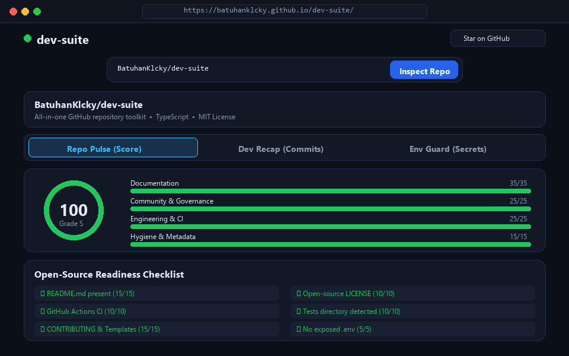
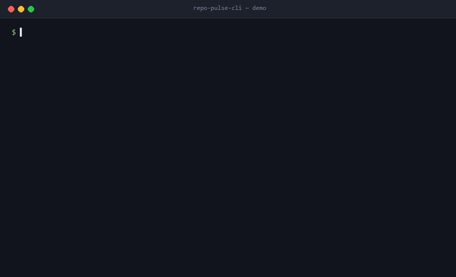

# dev-suite


**All-in-one open-source repository toolkit: Repo Pulse (open-source readiness), Dev Recap (Git commit insights), and Env Guard (`.env` & secret hygiene).**

🌐 **Try all 3 tools in your browser (zero install):** [batuhanklcky.github.io/dev-suite](https://batuhanklcky.github.io/dev-suite/)



## What's Inside `dev-suite`?

| Tool | Purpose | CLI / Access |
| :--- | :--- | :--- |
| **🩺 Repo Pulse** | 0–100 open-source readiness score, `S–D` grade & `--fix` auto-scaffolding | `npx repo-pulse-cli` · [Web](https://batuhanklcky.github.io/dev-suite/) |
| **📊 Dev Recap** | Git history stats, weekday charts, file hotspots & `CHANGELOG.md` generator | `npx dev-recap` · [Repo](https://github.com/BatuhanKlcky/dev-recap) |
| **🛡️ Env Guard** | `.env` leak detection, `.gitignore` rules, `.env.example` diff & secret scan | [Web Suite (Tab 3)](https://batuhanklcky.github.io/dev-suite/) |

---

## 1. 🩺 Repo Pulse (`repo-pulse-cli`)

Audits any local or remote GitHub repository across 4 categories (**Documentation**, **Community & Governance**, **Engineering & CI**, **Hygiene & Metadata**) and scaffolds missing essentials with `--fix`.

```bash
# Audit current directory
npx repo-pulse-cli

# Audit any public GitHub repository without cloning
npx repo-pulse-cli BatuhanKlcky/dev-suite

# Auto-generate missing LICENSE, CONTRIBUTING.md, Issue/PR templates, .gitignore & CI
npx repo-pulse-cli ./my-project --fix
```



---

## 2. 📊 Dev Recap (`dev-recap`)

Analyzes Git history with zero runtime dependencies and renders colorful terminal ASCII charts for weekday activity, Conventional Commit types, top contributors, and file hotspots.

```bash
# Analyze current git repository
npx dev-recap

# Analyze any public GitHub repository remotely
npx dev-recap BatuhanKlcky/dev-recap

# Filter by last 30 days & generate CHANGELOG.md
npx dev-recap --days 30 --changelog CHANGELOG.md
```

---

## 3. 🛡️ Env Guard (Web Suite)

Available directly in the **Env Guard** tab on [batuhanklcky.github.io/dev-suite](https://batuhanklcky.github.io/dev-suite/):

- Checks whether `.env` is accidentally committed to the repository root
- Verifies `.env` rules inside `.gitignore`
- Parses `.env.example` / `.env.template` and compares documented keys against `process.env`, `os.getenv`, and `import.meta.env` usage in source files
- Scans for common hardcoded token/secret patterns

---

## CLI Options (`repo-pulse-cli`)

| Option | Description |
| :--- | :--- |
| `[target]` | Local directory path, `owner/repo`, or GitHub URL (defaults to current working directory) |
| `--fix` | Auto-generate missing open-source essentials (local repos only) |
| `--dry-run` | Preview what `--fix` would create without writing to disk |
| `--json` | Output machine-readable JSON report |
| `--min-score <n>` | Exit with code `1` if score is below `<n>` |
| `--no-color` | Disable ANSI terminal colors |
| `-h, --help` | Show help message |
| `-v, --version` | Show version number |

## GitHub Actions Usage

Use **Repo Pulse** directly from the GitHub Marketplace as a CI quality gate:

```yaml
- uses: actions/checkout@v4
- uses: BatuhanKlcky/dev-suite@v1
  with:
    min-score: '80'
```

Or use **Dev Recap** in your workflow:

```yaml
- uses: actions/checkout@v4
  with:
    fetch-depth: 0
- uses: BatuhanKlcky/dev-recap@v1
  with:
    days: '30'
```

## Contributing

Contributions are welcome! Please read [CONTRIBUTING.md](CONTRIBUTING.md) before submitting a Pull Request.

## License

This project is licensed under the [MIT License](LICENSE).
